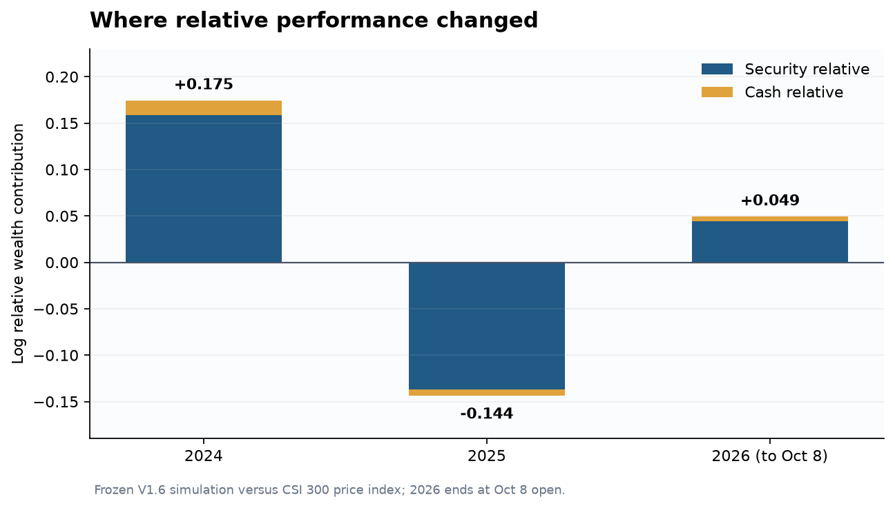

# Equity Alpha Lab｜沪深300多因子选股与组合归因

**个人量化研究项目 · Python / Qlib · 历史模拟，不是实盘业绩**

我研究的问题是：**月频股票排序信号经过换仓、交易成本和容量约束后，能否形成可信的沪深300相对收益；若有收益，它来自哪里？** 项目从历史成分与量价特征出发，比较简单因子、线性模型和树模型，在验证期选择并冻结策略，再把最终账户逐日、逐股拆开核算。仓库保留了失败候选和不能证明的结论。

| 一眼看结果 | 冻结组合 Equal8 + Buffer30/60 | 同期沪深300价格指数 |
|---|---:|---:|
| 2024-01-02至2026-10-08累计模拟收益 | **37.71%** | **27.10%** |
| 简单累计收益差 | **+10.61个百分点** | — |
| 2024年收益 | +36.74% | +14.85% |
| 2025年收益 | +1.90% | +17.66% |

最终期的账户是100万元起始的日线模拟，末日按开盘价估值、仍有35只股票，未计未来清仓成本；它没有真实成交或券商模拟盘证据。累计领先并不代表统计显著的Alpha：内部665个标准收盘区间的单市场Beta为0.367，线性年化回归截距8.55%，HAC p=0.210，95%区间跨越零。价格指数没有含股息，股票使用Qlib调整单位，**两侧总回报口径尚未独立对齐**。

## 这项研究给出了什么解释

最新的[逐股归因报告](reports/V18_ATTRIBUTION_REPORT.md)用冻结账户的1,475条订单事件、667个估值日重建了126只曾持有股票的模拟损益。逐股净损益合计**377,123.61元**，与期末账户资产增量的差异小于0.00001元；佣金和税费合计14,470.41元，成交滑点和冲击已计入成交金额。完整订单、逐日证券账与现金账只留本地，公开的是[年度相对收益拆分](reports/summary/v18_yearly_active_decomposition.csv)、[贡献集中度](reports/summary/v18_contribution_concentration.csv)和[主要证券](reports/summary/v18_top_security_drivers.csv)。

2024年组合净盈利36.74万元，前10只盈利证券贡献15.19万元；2025年仍盈利2.60万元，但同期价格指数涨17.66%，导致组合相对财富对数变化−0.1438。两年使用同一逐日链接算法：2024年股票相对项+0.1584、现金相对项+0.0161；2025年分别−0.1367、−0.0071。**2025的问题是没有跟上上涨的基准，不能简单说策略亏钱。** 相对贡献也不是行业配置、选股因果效应或可交易Alpha。



按当时持仓估计的历史个股Beta，2024、2025、2026年月均组合加权值约0.468、0.514、0.263；这是描述性[技术风格暴露](reports/summary/v18_technical_style_exposures.csv)，不能代替逐股市值/价值模型。对28个既有技术特征做月度Spearman IC与HAC检验后，**无一通过全体28项的FDR 5%校正**；最低原始p=0.0079对应q=0.221。这里没有根据最终期结果修改因子。[全部因子结果](reports/summary/v18_factor_significance.csv)。

我还用独立发布的[中国A股CH-4日频因子收益](https://en.mingshiim.com/database)做了事后风险回归。在因子日期完整的2024—2025年484个标准区间，四因子市场Beta约0.655，价值因子VMG载荷约+0.488；线性年化截距约**+0.83%，HAC p=0.885**，无法确认纯Alpha。CH-4提供比单沪深300价格因子更强的收益解释，但不代表可交易对冲回报或未来预测能力。因子源2026年6月缺17个账户交易日、8月后没有数据，因此没有把它冒充覆盖到最终期末的完整检验。[同样本单因子与CH-4结果](reports/summary/v18_ch4_regression.csv)。

研究也找到一处值得面试讨论的经济口径限制：组合持有中国银行2024-07-17除息日，上交所公告每股税前派息0.2364元；Qlib调整收益与由Qlib反推原价加税前股息的假设收益相差约10.8bp。[V1.8初步核对](reports/summary/v18_corporate_action_case.csv)当时只用Qlib反推原价；后续获得了独立的该两日价格（见下文），但真实股数与现金流仍缺失，不能推广为全期误差。22个证券日使用了陈旧估值，[年度敞口摘要](reports/summary/v18_stale_mark_summary.csv)已披露，但没有可成交价格来计算其真实影响。

**尚未证明的部分：** 历史行业标签与沪深300逐期权重不足，不能做合格的Brinson行业配置/选股分解；历史逐股市值和账面数据不足，不能报告规模/价值持仓暴露；沪深300全收益日线及独立未复权报价未完成核对，不能给出含股息基准超额。CH-4的时间缺口也限制全期四因子解释。2024—2026年已被看过，新的预测证据要靠未来时间样本。项目没有实盘、券商模拟盘或订单簿撮合。

**外部核对进展（2026-10-15）：** [第三方独立行情](https://quote.cfi.cn/cgtj/6090/601988.html)确认上述中国银行两日未复权收盘价为4.88/4.66元；结合发行人分红公告，税前单日收益0.3361%，与Qlib调整收益仍差约10.80bp。[外部核对与向前观察记录](reports/EXTERNAL_VALIDATION_AND_FORWARD_PROTOCOL.md)还提供固定CH-4模型的相关矩阵、VIF与年度系数：最大VIF 1.94，价值VMG载荷在2024和2025均为正。单日价格核对没有重建真实股数与现金账；全收益基准和合格历史行业权重仍缺失。向前信号已建立冻结协议和只追加登记程序，**截至2026-10-15尚无新的预先登记信号或未来业绩**。

## 方法与研究设计

研究股票池使用Qlib历史沪深300成分区间。月末收盘形成信号，下一交易日开盘按前收盘可知信息确定数量并执行；输入有8项基线量价因子与28项扩展技术特征。比较8种信号 × 2种组合，共16个候选，包括等权因子、Ridge、LightGBM、LambdaRank及组合。2020年及以前属开发；2021—2023年选模型；2024年以后作为**当时冻结后的一次**时间测试。选择规则和方案在[打开最终期前的提交](https://github.com/ryanmin188/equity-alpha-lab/commit/3a8663e50bb69dca774f9feff837bf70f46aa551)中固定。最终期逐月使用截至当时已成熟的标签更新训练，是冻结规则的一部分；最终期结果没有用于换策略。

最终选中的不是训练期收益最高的模型，而是验证期按事先约定规则领先的**Equal8 + Buffer30/60**：8因子固定方向等权，目标30只，旧持仓排名仍在前60时优先保留。旧开发期一个动量候选曾实现约100%模拟收益，但验证期亏损21.94%，因此没有采用。正式组合旧开发期收益11.36%，低于同期基准39.66%；**不能把别的候选成绩并入正式策略**。[全部候选与负结果](reports/V16_RESEARCH_REPORT.md)。

账户按100万元起始资金模拟，考虑最低佣金、日期适用的卖出税费、5bp设定滑点与平方根冲击、滞后成交额1%容量上限、手数、T+1、拒单和部分成交。它仍是日线近似，开盘真实盘口容量和正式涨跌停/停牌事件未被完全证明。[执行与压力测试](reports/V16_RESEARCH_REPORT.md) · [收益时间戳与市场回归](reports/V17_RETURN_AND_MARKET_ATTRIBUTION.md) · [V1.8逐股损益](reports/V18_ATTRIBUTION_REPORT.md)。


## 如何阅读与复现

求职面试中的专业因子评价补充见[V1.9.1 因子研究报告](reports/V191_FACTOR_RESEARCH_SUPPLEMENT.md)：对冻结面板的28项特征做预处理、IC/ICIR、五/十分组和冗余诊断；真实行业/市值中性化因缺少历史时点数据仍标为未完成。可配合[因子研究面试说明](reports/FACTOR_RESEARCH_INTERVIEW_GUIDE.md)阅读。

第一次看项目，建议依次读本页、[V1.8主要发现](reports/V18_ATTRIBUTION_REPORT.md)、[V1.6实验与执行](reports/V16_RESEARCH_REPORT.md)；[交互式HTML仪表盘](reports/research_dashboard.html)保留早期探索结果，其数据阶段与冻结最终测试不同，不能当作最新成绩。完整[文件结构](FILE_STRUCTURE.md)和[面试追问](reports/INTERVIEW_GUIDE.md)放在后面。GitHub会直接渲染Markdown报告和PNG图；HTML可下载本地打开，首页核心结果不依赖它。

Python 3.12，依赖见[requirements.txt](requirements.txt)。没有Qlib行情也可运行人工数据测试：

```powershell
python -m venv .venv
.\.venv\Scripts\python.exe -m pip install -r requirements.txt
.\.venv\Scripts\python.exe -m unittest discover -s tests -v
```

完整研究需自行取得有使用权限的[Qlib CN日频数据](https://github.com/microsoft/qlib/blob/main/docs/component/data.rst)，包含日历、历史CSI300成分区间、股票open/close/high/low/volume/factor和指数SH000300开收盘；本仓库不分发行情、缓存或完整交易账。原数据快照与复权方法会影响结果；[环境版本](environment_versions.json)和本地输入哈希可帮助核对，**不保证新机器独立复现同一数值**。

V1.6按[冻结协议](configs/v16_protocol.json)先运行 `research_v16_improvements.py --stage develop`，核对冻结结果后再运行 `--stage final` 与 `build_v16_report.py`。原最终期已打开，重跑仅属复现，不是新的样本检验。已有本地最终账户和行情缓存时，V1.8只需运行：

```powershell
python scripts/equity_alpha_v2/attribute_v18_holdings.py
```

输出的逐股CSV写入被Git忽略的本地 `outputs/v18_attribution/`；公开摘要在 `reports/summary/`。报告与程序分别写明调整单位、费用、相对贡献和外部数据缺口，不应把本项目表述为稳健盈利策略、已验证纯Alpha或真实交易业绩。

CH-4因子工作簿由[明汯数据库](https://en.mingshiim.com/database)单独下载，不随本仓库分发。保留原 `Returnseries` 工作表，按[V1.8报告](reports/V18_ATTRIBUTION_REPORT.md)中的命令运行 `attribute_v18_ch4.py --ch4-file <工作簿路径>`；脚本验证2024—2025每日覆盖并显式列出2026缺口。
