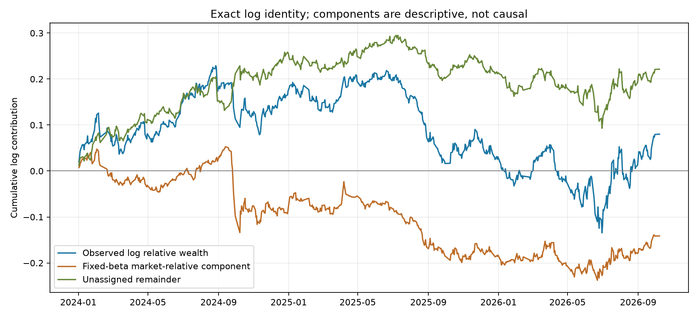
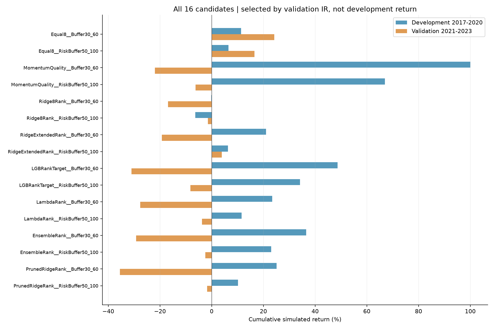
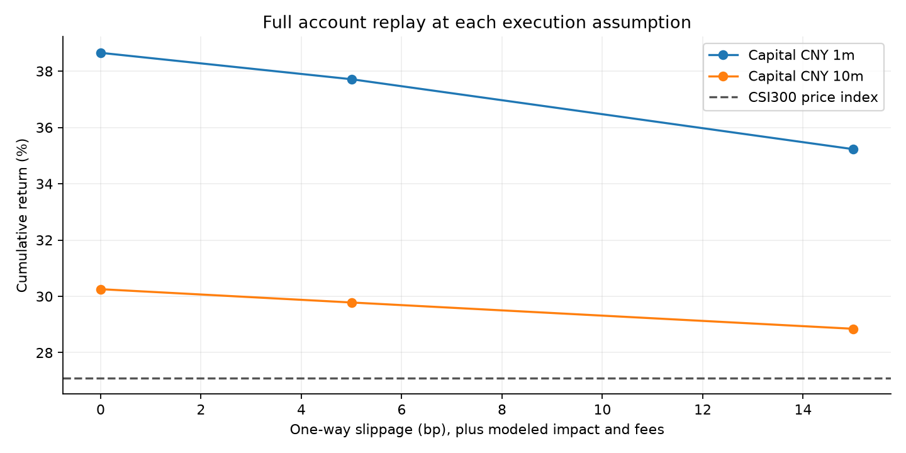

# Equity Alpha Lab 2.0

**沪深300多因子选股研究｜时序验证、组合执行与风险分析**

这个项目围绕一个问题展开：量价因子的预测排序，能否在考虑成本和成交约束后，转化为相对沪深300的收益？我保留了从简单因子、机器学习比较，到组合模拟和账户核对的完整过程，也保留了没有达到预期的实验。

冻结交易策略为 **V1.6**；**V1.7** 只审计其收益口径和市场暴露。最终时间测试中，事先冻结的组合累计模拟收益 **37.71%**，同期沪深300价格指数 **27.10%**，领先 **10.61个百分点**；年化收益 **12.27%**，每日最大回撤 **−12.42%**。这是一段历史模拟，尚无实盘或券商模拟盘记录，统计证据也不足以确认稳定的正alpha。

[V1.7收益归因审计](reports/V17_RETURN_AND_MARKET_ATTRIBUTION.md) · [V1.6研究报告](reports/V16_RESEARCH_REPORT.md) · [冻结协议与参考来源](reports/V16_PROTOCOL_NOTES.md) · [面试讲稿](reports/INTERVIEW_GUIDE.md) · [最终文件清单](FILE_STRUCTURE.md)


## V1.7 收益口径与市场归因

新一轮只使用V1.6已有的667条最终账户日记录，**未重训、未改仓位、未重跑交易，也不把2024—2026年重新称为独立样本**。[V1.7完整审计](reports/V17_RETURN_AND_MARKET_ATTRIBUTION.md) · [事先固定的分析协议](configs/v17_attribution_protocol.json) · [逐日口径CSV](reports/summary/return_convention_audit.csv)

首日双方都是开盘到收盘，末日双方都是上日收盘到当日开盘；账户与基准时间戳对齐，逐日身份式没有数值错误。但首日贡献了约1.90个百分点的当日相对收益，不能把首末行当作普通收盘到收盘区间。仅用内部665个标准区间，市场Beta为0.367，线性年化回归截距8.55%，HAC p=0.210；包含边界的旧口径为Beta 0.365、截距9.00%、p=0.189。两者都不支持确认正Alpha。

37.71%与27.10%的**简单累计收益差为10.61个百分点**；组合相对基准的财富比提高8.35%，对数相对财富为0.0802。按事先规定的固定Beta代数拆分，市场相对项为−0.1412，未分配剩余项为+0.2214。低Beta在整个基准上涨期形成拖累；剩余项混合了选股、风格、行业、成本与未建模误差，不能叫作纯选股Alpha。2024年贡献了主要相对优势，2025年则明显落后。



[滚动Beta、Alpha与跟踪误差图](reports/figures/v17_rolling_market_risk.png)。公开表只保留收益与计量误差；完整逐日现金、持仓价值与成本留在本地。已有V1.6最终每日账户CSV时，无需重新下载Qlib数据或重跑交易即可执行：

```powershell
python scripts/equity_alpha_v2/audit_v17_attribution.py
```

这一步没有外部A股因子收益、逐日行业分类或独立公司行动现金流；多因子和公司行动结论仍缺证据。

## 研究设计与结果

股票池使用Qlib历史沪深300成分区间；月末收盘形成信号，下一交易日开盘执行。比较8种信号与2种组合，共16个候选，涵盖等权因子、动量组合、Ridge、LightGBM、LambdaRank、排名集成和训练样本内因子筛选。扩展特征共28项，最多使用过去60个月已成熟的标签训练。

我将2020年以前使用过的数据作为开发样本，把2021—2023年用于选择，2024年起作为本次隔离的最终时间测试。未使用后两段做此前调整这一点来自项目使用者确认，不能替代第三方审计。选择规则、代码哈希和入选方案已在[打开最终测试前的提交](https://github.com/ryanmin188/equity-alpha-lab/commit/3a8663e50bb69dca774f9feff837bf70f46aa551)中保存；最终结果出来后没有再调参。

最后入选的是 **Equal8 + Buffer30/60**：8项因子按预定方向等权组合，优先保留仍排在前60的旧持仓，再补齐目标30只。它在验证期的信息比率最高，复杂模型没有胜过这一简单基线。

| 阶段 | 实际评估区间 | 冻结方案累计收益 | 同期基准 | 用途 |
|---|---|---:|---:|---|
| 开发 | 2017-02-03—2020-08-03 | 11.36% | 39.66% | 已用于研究，不能视为独立成绩 |
| 验证 | 2021-01-04—2023-12-01 | 24.25% | −32.97% | 选择模型与组合 |
| 最终测试 | 2024-01-02—2026-10-08 | **37.71%** | **27.10%** | 冻结后一次性评估 |

只纳入完整月度持有区间，所以实际日期不等于整年边界。最终测试期间按冻结规则逐月使用当时已经到期的标签重新训练；这不意味着允许根据最终成绩更换模型。

**关于“跑赢39.66%”：** 同一旧区间里，动量组合达到100.01%，LGB排名目标组合达到48.64%，但这些是开发期结果。前者验证期亏损21.94%，后者亏损30.98%，未按既定信息比率规则入选。正式冻结方案在旧区间并未跑赢39.66%；最终期则跑赢了它自己的同期基准。不同阶段、不同模型的成绩不能拼接成一个策略。



所有候选指标：[开发期CSV](reports/summary/v16_development.csv) / [验证期CSV](reports/summary/v16_validation.csv) / [最终期CSV](reports/summary/v16_final.csv)。原V1.5的最高累计模拟收益为27.98%，低于同期39.66%，旧报告保留在[版本归档入口](reports/RESEARCH_REPORT.md)。新旧样本处理、成本与组合规则不同，不能将差异全部归因于某个新模型。

## 执行约束与压力测试

- 本金100万元；信号日收盘决定数量，次日开盘成交；先卖后买，不允许透支。
- 佣金3bp、每笔最低5元，卖出印花税按2023-08-28分段，过户费采用固定假设；滑点5bp，另计平方根冲击。
- 单笔容量不超过滞后20日平均成交额的1%；处理手数、零股退出、T+1、缺价和价格限制代理。
- 目标单股权重上限5%、初始建仓后单次目标买卖总额上限80%；拒单与部分成交可能令实际持仓数超过30只。
- 逐日记录现金、持仓、费用和陈旧估值；独立事件重放核对两组最终账户，最大现金/NAV误差小于0.00001元。

把滑点改为0/5/15bp、资金改为100万/1000万元后，均完整重放账户。100万元、15bp滑点情景累计35.23%；1000万元、5bp情景累计29.78%，说明成本和规模会改变结果。



**执行边界：** 当前仍是日线近似，缺少盘口和开盘真实容量；ST/IPO正式限价资料不完整。Qlib复权单位映射不等于已核对真实股数、送转和现金分红。期末保留35只持仓，以开盘价估值，未扣以后清仓的费用。基准为价格指数，未计投资指数的费用，股票复权与基准总回报口径也未独立对齐。

## 结果值得怎样解读

最终期绝对收益和相对收益为正，但日频信息比率只有0.132。单市场因子回归的线性年化alpha约9.00%，HAC检验p=0.189，95%区间约[−4.44%, 22.44%]，不足以排除零alpha。平均日超额收益HAC检验p=0.828；累计领先不等于平均日超额显著。[统计口径与完整数据](reports/V16_RISK_STATISTICS.json)

这个项目更适合展示：如何区分开发、选择和检验，如何处理回测账户，为什么保留负结果，以及为什么不因复杂模型或漂亮曲线就宣布策略成功。它不能证明未来一定盈利，也还不是经过交易验证的指数增强产品。

## 七步流程完成到哪里

| 环节 | 已完成 | 仍需补足 |
|---|---|---|
| 数据处理 | 历史成分、预热、缺失与覆盖率、时间截断检查 | 独立行情源、历史数据修订与公司行动核对 |
| 因子构建 | 8因子基线、28项技术特征、训练样本内冗余筛选 | 基本面、行业/规模暴露、多期限衰减 |
| 策略搭建 | 月频多头、缓冲换股、等权/逆波动权重 | 真实指数权重与行业风险约束 |
| 模型训练 | 滚动成熟标签、Ridge/树/排序/集成比较 | 更长时期和跨市场稳健性 |
| 分层回测 | 原版IC与分组；新版日频账户、成本和拒单 | 真实盘口撮合与第三方成交核对 |
| 策略优化 | 16候选、验证选择、冻结最终测试、完整成本重放 | 宽参数稳定区间与更多独立时期 |
| 实盘风控 | 本地向前账本、限额、T+1、重复事件和回撤拦截 | 券商连接、实时行情、真实向前成交与运维 |

[向前账本使用方法](reports/FORWARD_PAPER_PLAN.md)。它不会把订单自动记为成交，目前没有真实向前业绩。仓库中的人工样本只验证程序行为。

## 复现

Python 3.12；直接依赖见 `requirements.txt`，本次环境见 `environment_versions.json`。在既有环境成功重跑，尚未验证全新机器安装；版本清单不是完整传递依赖锁文件。

```powershell
python -m venv .venv
.\.venv\Scripts\python.exe -m pip install -r requirements.txt
.\.venv\Scripts\python.exe -m unittest discover -s tests -v
```

目前11项人工数据测试通过，不需要下载行情，但需安装依赖。覆盖独立记账、拒单、未来标签不影响交易、信号数量先于开盘、滞后成交额、税费切换、零股退出、训练标签到期及向前账本限制。

### 数据准备

自行取得有权限使用的Qlib CN日频数据，参考[官方数据说明](https://github.com/microsoft/qlib/blob/main/docs/component/data.rst)。默认读取用户主目录 `.qlib/qlib_data/cn_data`，应包含 `calendars/day.txt`、`instruments/csi300.txt`、`features/`，以及股票 open/close/high/low/volume/factor 和基准 `SH000300` 的 open/close。

V1.6需要2010-01-01起的预热历史；本次本地日历延伸至2026-10-12。仓库不分发行情，不自动下载。不同数据快照、成分历史或复权方式可能改变结果；本次缓存哈希见核对记录，哈希本身不证明数据质量。

### V1.6运行顺序

```powershell
python scripts/equity_alpha_v2/research_v16_improvements.py --stage develop
python scripts/equity_alpha_v2/research_v16_improvements.py --stage final
python scripts/equity_alpha_v2/build_v16_report.py
```

`develop`仅载入截至2023年的行情，训练/比较候选并冻结配置与代码哈希；`final`检查冻结状态后只运行选定组合和预先指定基线。最终阶段打开后禁止再运行开发或最终阶段，以免悄悄反复挑选结果。若运行中断，需保留失败记录，不能删除标记假装测试未打开。复现者已看过仓库结果，其重跑也不算一个新的未触碰测试。

输出与大文件写入被Git忽略的 `scripts/equity_alpha_v2/outputs/v16_improvements/`。缓存与本地数据绑定；若更换数据，应使用独立研究副本和新协议，不能沿用旧缓存声称复现。报告生成器只更新V1.6报告、汇总与图表；README和面试稿需随经核对的结果同步维护。

### 原V1.0—V1.5

六个原始脚本仍位于 `scripts/equity_alpha_v2/`，顺序为 `run_research.py` → `audit_v11_accounting.py` → `research_v12_factors.py` → `research_v13_risk.py` → `build_v14_report.py` → `finalize_v15_release.py`。原输出写入独立的 `outputs/v1_csi300/`。完整重跑的五项核心输出与原结果哈希一致，见[原版本复现记录](reports/REPRODUCTION_CHECKS.json)。原发布状态仅是研究内部检查通过。

## 目录与展示

```text
equity-alpha-lab/
├── README.md
├── FILE_STRUCTURE.md
├── requirements.txt
├── environment_versions.json
├── .gitignore
├── configs/v16_protocol.json
├── scripts/equity_alpha_v2/   # 原六脚本 + V1.6研究、执行、报告、向前账本
├── tests/                    # 纯模拟样本测试
└── reports/                  # 中文报告、冻结记录、图表和少量聚合指标
    ├── figures/
    └── summary/
```

GitHub首页直接展示净值、全部候选和执行压力图，Markdown报告也可直接读。[旧版HTML仪表盘](reports/research_dashboard.html)保留为V1.5归档，下载后可用浏览器打开；它没有包含V1.6新结果。GitHub文件页不执行HTML，本仓库未把尚未部署的Pages地址当作已上线页面。

仓库排除行情、虚拟环境、缓存、逐股预测、交易/持仓明细和凭证。保留原始本地研究资料，发布包只包含展示与复现所需文件。

## 参考与工作说明

Qlib提供数据和研究框架，LightGBM提供树与排序模型；特征、组合和评价方案参考其公开文档并在本项目内实现，详见[来源与实现边界](reports/V16_PROTOCOL_NOTES.md)。代码整理、测试和说明使用AI辅助，研究结论以实际运行记录为依据。面试时应能解释自己理解、核对和修改的部分，保留第三方贡献说明。
