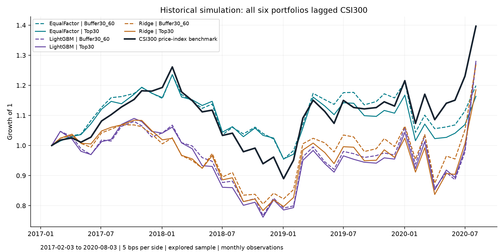
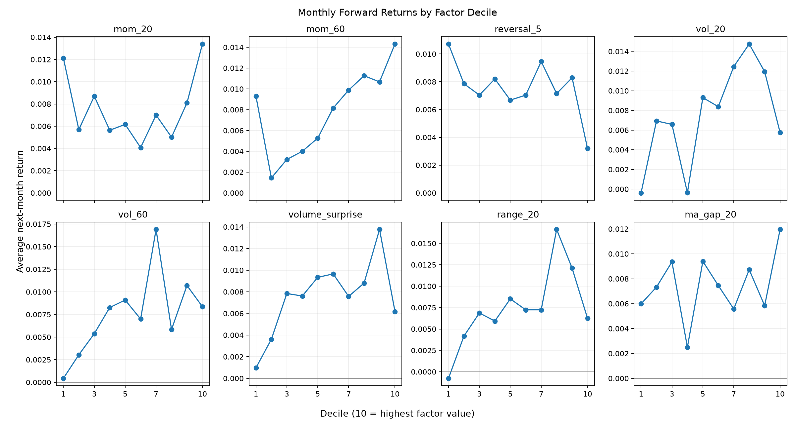
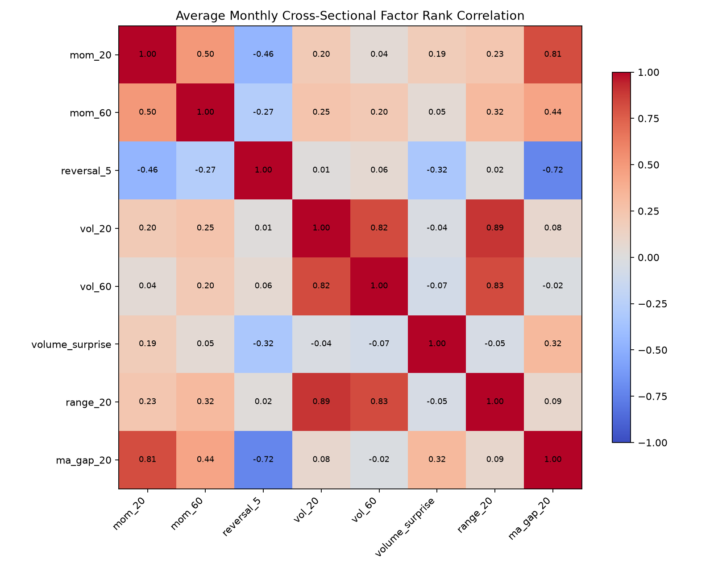
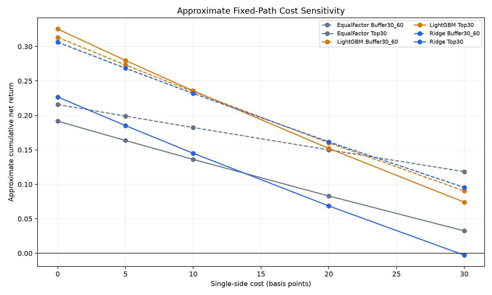

# Equity Alpha Lab 2.0

**沪深300多因子选股：从预测信号到组合收益与风险归因**
CSI300 factor research · rolling prediction · portfolio simulation · accounting audit

这是一个可用于量化研究面试的历史探索性研究项目。核心问题是：**预测排序能力，是否能转化为扣费后、相对基准的收益？**

**研究结论：六个组合的历史累计模拟收益均为正，但均落后于同期沪深300价格指数；没有证据确立显著的正 alpha。** 评估区间已在开发中使用，不能称为未触碰的最终测试集。没有实盘或券商模拟盘记录。

[研究报告](reports/RESEARCH_REPORT.md) · [流程审核](reports/METHODOLOGY_REVIEW.md) · [面试讲稿](reports/INTERVIEW_GUIDE.md) · [HTML 仪表盘文件](reports/research_dashboard.html) · [复现核对记录](reports/REPRODUCTION_CHECKS.json)

## 30 秒了解项目

- 历史沪深300成分区间，29,611 条股票月度观测，8 个量价因子。
- EqualFactor、Ridge、LightGBM；按月滚动训练，最多回看48个月，仅使用已到期标签。
- Top30 和 Buffer30/60 两种组合规则；6个组合、42个月、252条账户月度记录。
- 因子 Rank IC、十分组、相关性、HAC检验；现金/持仓记账、拒单、陈旧估值、风险归因与成本敏感性。
- 发布复核：六脚本完整重跑；五项核心输出与旧结果 SHA-256 完全一致；3项人工数据测试通过。

## 结果先与基准比较

持有区间：**2017-02-03 至 2020-08-03**，42个月；单边固定成本5bp。以下是整段累计收益，**不是年收益**。年化按12个月/年计算。最大回撤根据月频观测计算，不能当作日内或每日最大回撤。

| 模型 | 组合 | 累计模拟收益 | 年化收益 | 月频最大回撤 | 市场 Beta |
|---|---|---:|---:|---:|---:|
| EqualFactor | Buffer30_60 | 19.90% | 5.32% | -22.75% | 0.721 |
| EqualFactor | Top30 | 16.36% | 4.42% | -22.69% | 0.736 |
| LightGBM | Buffer30_60 | 27.33% | 7.15% | -29.01% | 1.271 |
| LightGBM | Top30 | 27.98% | 7.30% | -30.13% | 1.248 |
| Ridge | Buffer30_60 | 26.85% | 7.03% | -24.63% | 1.081 |
| Ridge | Top30 | 18.52% | 4.97% | -27.71% | 1.091 |
| **CSI300 基准** | **价格指数** | **39.66%** | **10.02%** | **-29.45%** | **1.000** |

基准来自 Qlib `SH000300` 同期开盘到开盘的价格指数收益，未模拟投资指数的费用，也未确认总回报指数口径。股票复权、分红与真实现金/股数尚需独立核对；比较不是可交易指数增强业绩证明。



Ridge / LightGBM 的平均月度 Rank IC 为0.03672 / 0.03033，但HAC p值为0.08434 / 0.07172；模型间配对IC差异不显著。所有组合的市场模型年化截距点估计均为负，不能由正收益推出选股 alpha。[完整指标CSV](reports/summary/risk_attribution.csv)

## 七步量化流程：本项目覆盖到哪里

| 环节 | 已实现 | 当前边界 |
|---|---|---|
| 数据处理 | Qlib历史成分、日历、OHLCV；无穷值处理、横截面截尾标准化、训练集缺失值填补 | 依赖数据源；没有独立核对原始行情、公司行动和成分公告时点 |
| 因子构建 | 动量、反转、波动、成交量、振幅、均线偏离，共8项 | 仅量价；没有基本面、行业中性化或多期限衰减 |
| 策略搭建 | Top30等权、Buffer30/60保留/换股规则 | 简化的股票多头策略，不是高频或完整指数增强优化器 |
| 模型训练 | 固定参数；历史滚动训练；标签到期过滤 | 缺少隔离的验证集选参与未触碰最终测试集 |
| 分层回测 | Rank IC/十分组诊断；带成本的现金持仓账户 | 分组收益不是可交易多空收益；缺少真实撮合、冲击与完整费率 |
| 策略优化 | 缓冲规则、分年度与成本情景比较 | 未完成宽参数平台、跨市场压力测试；成本情景是固定路径近似 |
| 实盘风控 | 离线回撤、Beta、拒单、现金与陈旧估值诊断 | 尚无券商连接、事前限额、实时监控、熔断或实盘运维 |

## 更多可直接查看的图表



十分组仅对可观测未来收益做事后诊断，未计成本，缺失标签可能影响样本组成。





成本图使用固定交易路径的一阶近似，并非换费率后重跑账户。没有保证可以按5bp成交。

## 本地复现

使用 Python 3.12。`requirements.txt` 是原研究环境的直接依赖版本，`environment_versions.json` 是环境记录；它们不是含所有传递依赖的完整锁文件。此次在既有环境完整重跑成功，**没有验证全新机器的依赖安装**。

```powershell
python -m venv .venv
.\.venv\Scripts\python.exe -m pip install -r requirements.txt
.\.venv\Scripts\python.exe -m unittest discover -s tests -v
```

最后一条使用内存生成的虚构证券和价格，不需要行情数据；仍需安装上述Python库。覆盖无法卖出时的持仓保留、独立现金流水重算、未来标签缺失不改变交易，以及训练标签到期约束。测试通过不代表策略盈利。

### 行情准备

请自行取得有使用权限的 Qlib CN 日频数据。参考 [Qlib 官方数据说明](https://github.com/microsoft/qlib/blob/main/docs/component/data.rst)。本仓库不附行情、不自动下载，不声称换用任何最新版数据都能复现相同数字。

默认路径为用户主目录下 `.qlib/qlib_data/cn_data`，应含 `calendars/day.txt`、`instruments/csi300.txt` 与 `features/`。必须提供2012-01-01至2020-08-31期间所需的历史成分区间、股票 open/close/high/low/volume，以及 `SH000300` 的 open。使用其他目录时修改 `run_research.py` 的 `QLIB_DATA`。匹配数据快照、复权定义和依赖环境才有可能重现历史数字；数据摘要见复现记录。

在仓库根目录依次运行：

```powershell
.\.venv\Scripts\python.exe scripts/equity_alpha_v2/run_research.py
.\.venv\Scripts\python.exe scripts/equity_alpha_v2/audit_v11_accounting.py
.\.venv\Scripts\python.exe scripts/equity_alpha_v2/research_v12_factors.py
.\.venv\Scripts\python.exe scripts/equity_alpha_v2/research_v13_risk.py
.\.venv\Scripts\python.exe scripts/equity_alpha_v2/build_v14_report.py
.\.venv\Scripts\python.exe scripts/equity_alpha_v2/finalize_v15_release.py
```

输出写入被Git忽略的 `scripts/equity_alpha_v2/outputs/v1_csi300/`。V1.4/V1.5脚本生成自动报告及基础发布包；首页、面试说明和审核注释是本次人工审核后的发布材料，不会自动随重跑更新。若改变数据或逻辑，必须同步重新核对发布报告，不能继续引用旧成绩。

## HTML 怎么查看

HTML是完整、独立的研究仪表盘，包含内嵌图像与脚本，可下载后在浏览器打开；它并非只能临时查看。GitHub文件页不会把它当网站执行。面试官无需打开HTML，也能在本页看到图表和结论，Markdown报告也可直接阅读。

需要在线交互时，可另外用 [GitHub Pages](https://docs.github.com/en/pages/getting-started-with-github-pages/creating-a-github-pages-site) 发布HTML。本次不把尚未部署的Pages地址写成已上线链接。

## 已知局限与下一步

1. 先冻结研究方案，新增未参与开发的时间段作最终测试，不能反复用2017–2020选策略。
2. 核对真实价格、复权与分红，补涨跌停、停牌、手数、税费、滑点和冲击成本，再重跑账户。
3. `volume_surprise` 当前实现的均量窗口是 t−21 至 t−2，跳过t−1；它仍只用历史数据，但不同于常见“前20日”定义。本次保留公式和历史结果；修订后需重新命名版本、重新评估。
4. 评估行业、规模等暴露及因子冗余，检验增量信息与参数稳定性。
5. 在历史证据足够后再做向前模拟与实时风控；本次历史重跑不属于向前模拟盘。

`PASS_INTERNAL_IDENTITIES_ONLY` 仅表示模拟器输出的内部恒等式通过；`RESEARCH_RELEASE_CANDIDATE` 不表示实盘验收或稳定获利。

## 仓库内容与数据边界

保留源码、研究报告、静态图表、少量聚合指标和虚构样本测试。排除行情、`.venv/`、IDE配置、pickle面板、逐股预测、交易/持仓明细和凭证。未授予第三方数据的再分发许可；未额外添加未经作者确认的开源许可证。

For research and interview demonstration only. Historical simulation is not live performance or investment advice.
