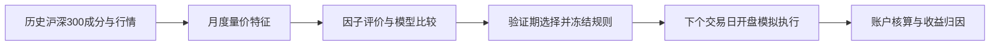
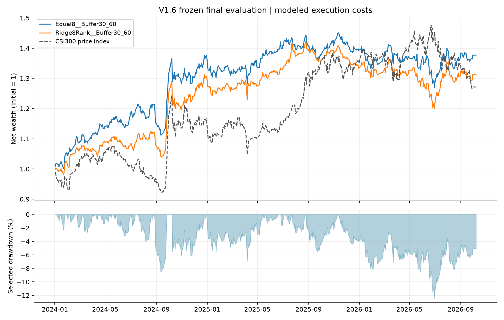

# Equity Alpha Lab

**沪深300股票池的多因子选股、模拟执行与收益归因** · Python / Qlib · 个人量化研究项目

这个项目研究一个实际的选股问题：月度量价信号在经过样本外选择、换手控制和交易约束后，是否仍能产生相对收益？研究从历史成分股和日频行情出发，贯通因子评价、模型比较、组合构建、逐日交易模拟和持仓归因。最终选择的是规则清晰的 **Equal8 + Buffer30/60**，而非训练期收益最高的候选。

**快速体验：** [在线交互式研究展示](https://equity-alpha-lab-research.brinycharm64.chatgpt.site)可切换组合、因子与研究边界三个视角；[无行情合成 Demo](examples/README.md)直接运行项目原有执行引擎。两者均与冻结策略的历史结果明确区分。

## 策略与研究流程



- **股票池与信号：** 使用 Qlib 历史沪深300成分区间，月末收盘形成信号。比较固定方向的八因子等权信号，以及 Ridge、LightGBM、LambdaRank 等候选；扩展的28项技术特征用于独立因子评价。
- **组合规则：** Equal8 将八项因子按预设方向等权合成；每次目标持有30只，原持仓排名仍在前60时优先保留，以降低不必要的换手。
- **时间切分：** 2020年及以前用于开发，2021—2023年用于验证和选择。组合规则在打开2024年以后结果之前[固定于版本记录](https://github.com/ryanmin188/equity-alpha-lab/commit/3a8663e50bb69dca774f9feff837bf70f46aa551)。最终期按冻结流程逐月更新已成熟标签，不用最终期表现重新选择策略。
- **执行建模：** 100万元初始资金；下一交易日开盘成交，纳入佣金、日期适用的卖出税费、5bp设定滑点、平方根冲击、滞后成交额容量上限、手数、T+1、拒单与部分成交。
- **执行偏差诊断：** 独立比较目标权重、实际成交权重与日末估值权重，并检查最小申报手数、未成交旧仓和超权重持仓对结果的影响；[合成示例](examples/README.md)可直接切换三种执行规则。

## 历史模拟结果

| 区间 | 冻结组合 | 沪深300价格指数 |
|---|---:|---:|
| 2024-01-02—2026-10-08累计收益 | **37.71%** | 27.10% |
| 2024年 | **36.74%** | 14.85% |
| 2025年 | 1.90% | **17.66%** |

全期简单累计收益差为 **+10.61个百分点**。2024年贡献了主要相对优势；2025年组合仍取得正的绝对收益，但明显落后于上涨的基准。图中的期末账户按开盘价估值，因此2026年并非完整自然年。



持仓账本将667个估值日、1,475条模拟订单和126只曾持有证券的损益逐项汇总：证券毛损益 **391,594.02元**，交易费用 **14,470.41元**，净损益 **377,123.61元**；与账户净资产增量的差异小于0.00001元。这使年度表现可以进一步追溯到股票和交易，而不只是一条净值曲线。


## 因子与风险解释

在完全相同的2024—2025年484个标准日收益区间，使用外部 A 股 CH-4 因子收益进行事后回归：单市场模型的线性年化截距为 **7.84%**（HAC p=0.298）；加入规模、价值和动量因子后为 **0.83%**（HAC p=0.885），模型 R² 从0.372升至0.623。组合对价值因子 VMG 的载荷约 **+0.488**。这个结果提示价值风格是收益的重要解释线索，现有样本尚不能支持“稳定的独立 Alpha”结论。

另对冻结面板的28项技术特征计算月度 Rank IC、ICIR、五组/十组股票收益，并用 Benjamini–Hochberg 方法校正多重检验。在已经打开的最终期33个月中，**没有单因子通过5% FDR**；因子相关诊断识别了7对高相关候选。因子评价没有改变上述冻结组合。

## 代码与复现

初次接触项目，可以先用 Python 3.12 运行不依赖 Qlib 行情的示例：

```bash
python -m pip install -r examples/requirements.txt
python examples/demo.py
```

示例生成10只合成证券与4次调仓，输出订单、费用和净值；其收益不是本页37.71%的历史研究结果。[展示页源码](showcase/README.md)的数据则来自已经保存的聚合摘要，[只读数据文件](showcase/data/research.json)记录了源文件哈希，便于追溯。

| 内容 | 入口 |
|---|---|
| 研究主流程与模型比较 | [`research_v16_improvements.py`](scripts/equity_alpha_v2/research_v16_improvements.py) |
| 模拟执行与账户 | [`execution_v16.py`](scripts/equity_alpha_v2/execution_v16.py) |
| 执行偏差与持仓控制 | [`execution_v22.py`](scripts/equity_alpha_v2/execution_v22.py)、[`research_v22_execution.py`](scripts/equity_alpha_v2/research_v22_execution.py) |
| 持仓损益与风险归因 | [`attribute_v18_holdings.py`](scripts/equity_alpha_v2/attribute_v18_holdings.py)、[`attribute_v18_ch4.py`](scripts/equity_alpha_v2/attribute_v18_ch4.py) |
| 因子评价与截面中性化框架 | [`factor_research_v191.py`](scripts/equity_alpha_v2/factor_research_v191.py)、[`factor_neutralization_v191.py`](scripts/equity_alpha_v2/factor_neutralization_v191.py) |
| 冻结配置与数值测试 | [`configs/`](configs/)、[`tests/`](tests/) |

完整研究环境的依赖见 [`requirements.txt`](requirements.txt)。无需行情数据即可运行合成数据测试；GitHub Actions 也只执行这些合成与数学性质测试：

```powershell
python -m venv .venv
.\.venv\Scripts\python.exe -m pip install -r requirements.txt
.\.venv\Scripts\python.exe -m unittest discover -s tests -v
```

完整历史研究需自行准备有使用权限的 [Qlib 中国市场日频数据](https://github.com/microsoft/qlib/blob/main/docs/component/data.rst)及历史沪深300成分区间；外部 CH-4 因子数据需从[原发布方](https://en.mingshiim.com/database)取得。仓库不分发行情、完整交易账或第三方工作簿。这里展示的是**历史模拟和事后归因**，基准为沪深300价格指数；模拟成交、股息总回报和未来表现均不能等同于实盘投资结果。
