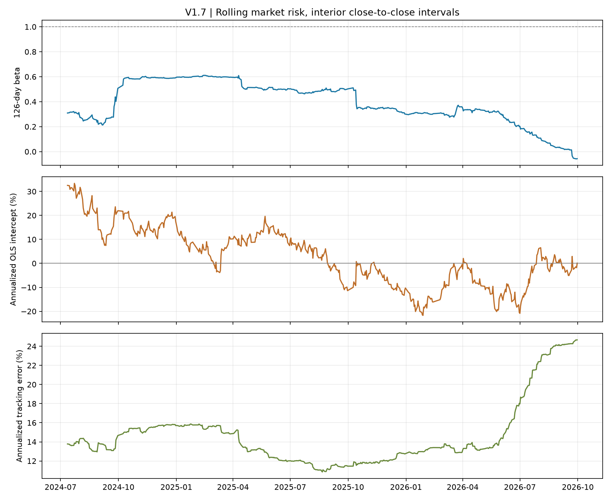

# V1.7 收益口径与市场归因审计

本报告仅解释已经打开过的V1.6最终区间。**Equal8 + Buffer30/60信号、组合、成交与成本均未改变；没有重新训练或重跑交易账户。** 本报告是事后解释，不是一次新的最终测试。[事先固定的分析协议](../configs/v17_attribution_protocol.json)在计算前单独提交，输入是本地保存的最终账户CSV。完整现金与持仓核对表留在被Git忽略的本地输出；公开审计表仅包含收益区间、净值与身份式误差。

## 1. 收益口径审计

账户从2024-01-02开盘前100万元现金起算。首行策略含当天开盘建仓、费用与收盘估值，基准以同日开盘作1的起点、收盘估值。中间665个区间为上个交易日收盘至本日收盘，策略在区间内可于开盘交易。末行2026-10-08为上个交易日收盘至当天开盘，双方都以开盘估值；策略仍持有35只股票，未强制清仓。**两条序列的边界时间戳一致，但首末行并非标准收盘到收盘收益。**

首日组合收益0.74%、基准收益-1.17%，简单日差为1.90个百分点，对数相对贡献0.0191。末日两者分别为0.02%、-0.06%，对数相对贡献0.0008。纯内部665个区间的对数相对贡献为0.0602；它与完整期的0.0802起止时间不同，不能直接拿其回报率冒充完整期成绩。

逐行由账户净值、现金加持仓和基准归一化财富重建收益；策略日收益最大误差5.33e-16，NAV身份式最大误差4.66e-10元。费用与滑点逐日求和与V1.6汇总一致；基准末值与汇总差2e-08，属于保存浮点精度范围。CSV没有原始指数点位或独立供应商价格，故只能验证**内部归一化收益**，不能独立证明基准开收盘原始报价或每个交易日都齐全。

[逐日口径核对CSV](summary/return_convention_audit.csv) · [边界、陈旧估值和未核对事项](summary/return_convention_anomalies.csv)。异常文件中的INFO是设计边界，WARNING为陈旧估值，UNVERIFIED指缺失外部核据；数值身份式没有ERROR。22个估值日存在至少1只持仓使用陈旧价格，合计22个持仓日，收益仍受这些估值假设影响。

## 2. 累计收益、相对财富与对数路径

期末组合财富1.377124，基准财富1.271043。它们的简单累计收益差为 **10.61个百分点**；相对财富收益为 **8.35%**；对数相对财富为 **0.0802**。三个量有不同单位与含义，不能互换。逐日对数相对收益求和与最终财富比的对数逐位一致。

使用下节预先指定的内部区间Beta=0.367，将每天的对数相对收益恒等分为“固定Beta市场相对项”与“未分配剩余项”：全期分别为 **-0.1412** 和 **0.2214**，相加等于0.0802。由于全期基准上涨，低市场Beta的市场相对项在此定义下为负，形成拖累。剩余项混有个股选择、风格、行业、交易成本、估值及模型误差，**不能命名为纯选股Alpha**。Beta为事后估计、这种代数拆分也不是可交易的对冲组合或因果归因。

## 3. 市场回归：固定主口径与边界敏感性

主口径使用**内部665个收盘到收盘区间**，普通OLS加HAC(5)标准误、零无风险利率、单沪深300价格指数因子：Beta 0.367；线性年化截距 8.55%；HAC p=0.210；95%区间 [-4.83%, 21.94%]；年化跟踪误差 16.25%。

作为事先规定的边界敏感性，完整667区间包含首日开盘到收盘及末日收盘到开盘：Beta 0.365；线性年化截距 9.00%；HAC p=0.189；95%区间 [-4.44%, 22.44%]；年化跟踪误差 16.26%。 这重现V1.6原回归的约9.00%线性年化截距。两种口径一并报告；没有因为显著性不同而换主结果。

单因子截距是**未解释的统计回归项**，含缺失风格、行业和公司行动误差；短样本、日收益相关性与已打开测试期的事后分析限制推断。即使某个p值小于阈值，也不能据此宣称已识别经济Alpha。[完整回归CSV](summary/v17_market_regressions.csv)

### 分年度区间

|   年份 | 起点       | 终点       |   区间数 | 组合收益   | 基准收益   |   对数相对收益 |   Beta | 年化截距   |   截距p值 | 跟踪误差   |
|-------:|:-----------|:-----------|---------:|:-----------|:-----------|---------------:|-------:|:-----------|----------:|:-----------|
|   2024 | 2024-01-02 | 2024-12-31 |      242 | 36.74%     | 14.85%     |         0.1745 |  0.53  | 23.70%     |     0.03  | 14.91%     |
|   2025 | 2025-01-02 | 2025-12-31 |      243 | 1.90%      | 17.66%     |        -0.1438 |  0.404 | -4.78%     |     0.538 | 12.49%     |
|   2026 | 2026-01-05 | 2026-10-08 |      182 | -1.17%     | -5.94%     |         0.0494 |  0.055 | -0.58%     |     0.966 | 21.56%     |

年度收益按该年观测区间复利；2024从首个开盘起、2026仅到10月8日开盘，不是完整自然年。年度回归仍只用内部标准收盘到收盘区间；各年样本短，p值为描述而非重新择模依据。[年度原始汇总](summary/v17_calendar_segments.csv)

可见全期相对优势主要形成于2024年：该段对数相对收益0.1745；2025年为-0.1438，抵消了不少优势；2026年截至10月为0.0494。2024年单独回归的p值不能视为多次分段考察后得到的独立发现。全期账户平均现金权重为4.69%，因此低Beta也不能仅凭现金仓位解释；需要股票层面风险暴露数据进一步核对。

### 126个交易日滚动估计

Beta、线性年化截距和年化跟踪误差按固定126个内部区间逐日滚动估计；图仅用于识别时变风险，没有逐点做显著性筛选。[滚动CSV](summary/v17_rolling_market_risk.csv)

## 4. 经济解释的边界

这一步能确认计量边界没有把策略与基准错位，并量化市场暴露与仍未解释的相对财富。**不能据此区分个股选择、风格或行业配置。** 仓库没有经独立核准的A股规模/价值/动量因子收益序列和逐日行业映射；股票特征排名不能充当因子收益。也没有外部公司行动现金流源，不能宣称已核对分红送转。

下一步是否取得外部数据，应先看可靠来源、授权与日期对齐成本。若要作真正的多因子或公司行动核对，应另定协议并完整保留所有结果；2024—2026年已用于本次分析，任何后续改动也不能再称作对此期间的全新最终测试。

输入CSV的SHA-256：`e4464d340e2237434a75d63d917cfc367a7ea7ca5b3e950c97cec80524815a83`；原汇总CSV的SHA-256：`53c8c825c308ab70b2f4f694b9907a1ce732049bcbba69f3fd3869675805c14a`。这些指纹便于核对本次读入文件，无法替代原始行情和券商账单。
